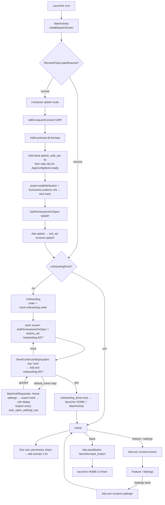
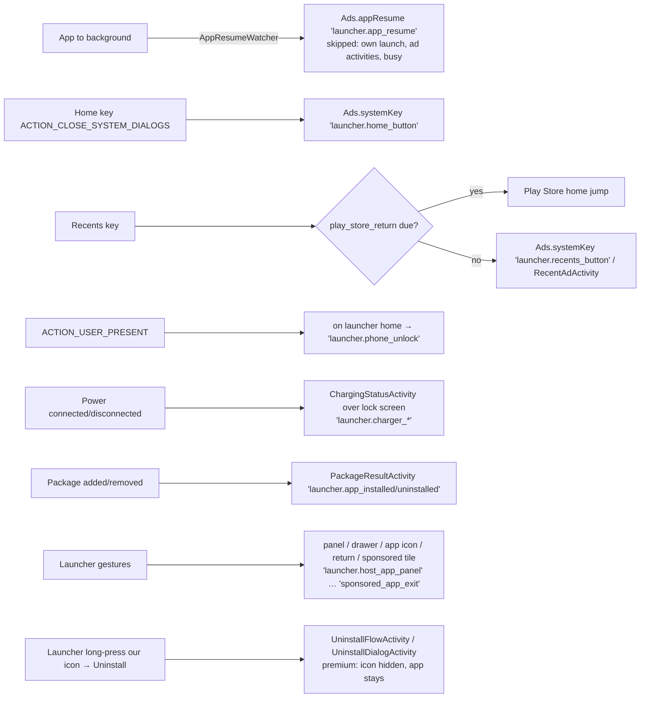
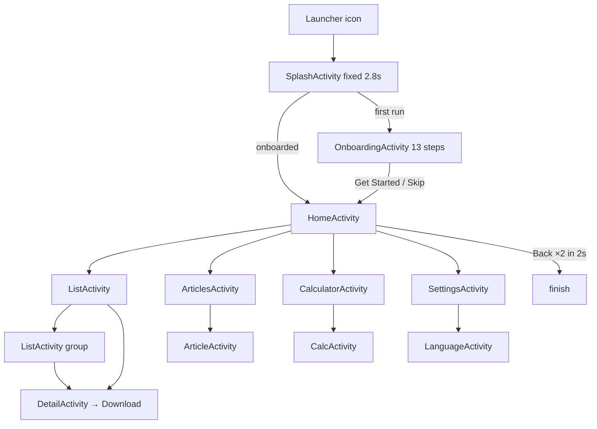
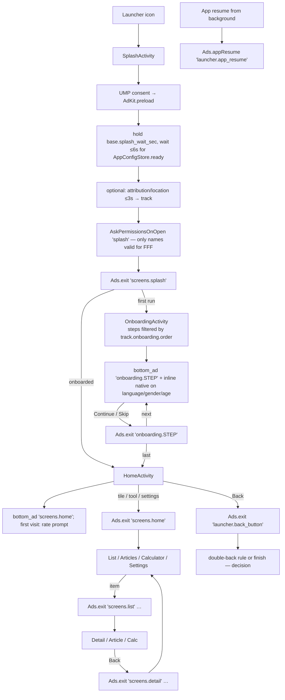

# App Flow Diagrams

Mermaid diagrams (render in GitHub / Android Studio Markdown preview). Place keys in `quotes` are Remote Config ad places (see `ADS_COMPLETE_MAPPING.md`).

## 1. Reference app — cold start to Home (`:app`, Compose single Activity)

## 2. Reference app — background triggers

## 3. FFF today

## 4. FFF target (proposed — infrastructure from the reference, FFF screens kept)

Launcher, uninstall flow, Recents/Home-key ads and event screens are **not** in the FFF target unless approved (see Pending questions in `REFERENCE_VS_TARGET_COMPARISON.md`).
