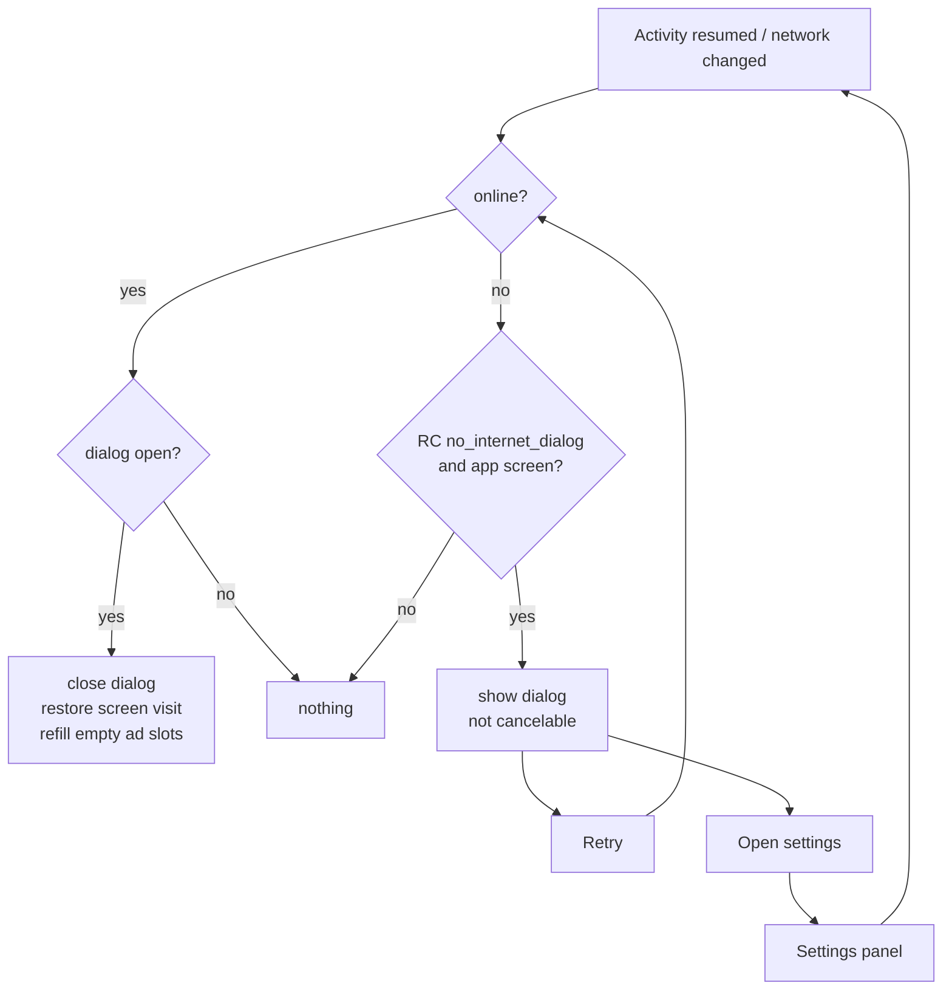

# No internet dialog: plan and porting guide

A "No internet access" dialog over the app's own screens while the phone is offline. Built and tested in **Skin Emotes**
(TECNO KN8s, Android 16, 2026-10-31). This file is written so the same feature can be added to another app
(the AppKit stack: `ads` module + `launcher` module + Firebase Remote Config).

---

## 1. What the user sees

```
                 ANY APP SCREEN (splash, onboarding, home, lists, details, settings…)
                                         │
                NoInternet (one ConnectivityManager callback for the whole app)
                                         │
              ┌──────────────── internet lost ────────────────┐
              ▼                                               │
   ┌───────────────────────────────────┐                      │
   │          📶  (wifi-off icon)       │                      │
   │        No internet access          │                      │
   │  Check your Wi-Fi or mobile data   │                      │
   │  and try again.                    │                      │
   │                                    │                      │
   │  [            Retry             ]  │                      │
   │           Open settings            │                      │
   └───────────────────────────────────┘                      │
     Can't be closed: Back, outside tap and drag do nothing   │
              │                                               │
     Retry ─► check again ─► still offline → icon shakes      │
     Open settings ─► Android "Internet" panel (Wi-Fi/data)   │
              │                                               │
              └────────── internet back (auto-detected) ──────┘
                                         ▼
                 Dialog closes by itself → the screen carries on
                 (splash: RC fetch + ads; empty ad slots load again)
```

### Splash, first install with no internet

```
Splash ─► offline? ─YES─► dialog, splash paused ─► internet back ─► fetch RC again ─► consent ─► preload ─► splash ad ─► route
                  └─NO──► normal flow
```

Without this, a first install opened offline runs on the code defaults (ads off, launcher off, organic) until the next
launch. With it, the splash waits for the connection and gets the real Remote Config.



---

## 2. Where it shows

| Shows over | Never shows over |
|---|---|
| Every activity whose class is in the **app** package (splash, onboarding, home, lists, details, calculators, settings, language, uninstall flow) | **Launcher home** (launcher module package): as the default home, blocking it would lock the user out of the phone |
| | Ad screens (AdMob `AdActivity`), Custom Tabs / browser |
| | `ads` module event screens (charger, unlock, install/uninstall result) |
| | The transparent uninstall system-style dialog (`UninstallDialogActivity`) |

The rule is one line: `activity.javaClass.name.startsWith("<app package>.")`, minus the excluded transparent dialogs.

---

## 3. Remote Config

| Key | Type | Default | Meaning |
|---|---|---|---|
| `base.no_internet_dialog` | bool | **true** | offline: the app's screens show the dialog until the connection is back, and the splash waits for it. `false` = old behaviour (ads just skip, app works offline) |

The code default is `true`, so a first install offline (no RC yet) still gets the dialog.

---

## 4. Files (porting checklist)

| # | File | Change |
|---|---|---|
| 1 | `app/.../core/system/NoInternet.kt` | **new**: watcher + dialog (code in §5) |
| 2 | `app/src/main/res/layout/sheet_no_internet.xml` | **new**: icon, title, text, Retry, Open settings (§6) |
| 3 | `app/src/main/res/drawable/ic_wifi_off.xml` | **new**: Material "wifi off" vector, tinted with the primary colour |
| 4 | `values*/strings.xml` | `net_title`, `net_body`, `net_retry`, `net_settings` in **every** language folder (§7) |
| 5 | `App.kt` | `NoInternet.install(this) { AppConfigStore.current.value.base.noInternetDialog }` (after `SystemKeys.listen`) |
| 6 | `AppConfig.kt` / `AppConfigParser.kt` | `BaseConfig.noInternetDialog: Boolean = true` ← `b.bool("no_internet_dialog", true)` |
| 7 | `AppConfigStore.kt` | `syncIfNeverFetched(context)` (§8) |
| 8 | `SplashActivity.kt` | wait for the network at the start of the startup coroutine (§8) |
| 9 | `ads/.../Ads.kt` | remember bottom / list slots; `refillEmptySlots(activity)` (§9) |
| 10 | `tools/gen_remote_config.py`, `app_config*.json`, `RC_GUIDE.md`, parser test | add the key; regenerate; `assertTrue(c.base.noInternetDialog)` |

`ACCESS_NETWORK_STATE` is already in the `ads` module manifest (merged into the app).

---

## 5. `NoInternet.kt`

Replace `APP_PACKAGE`, the binding name and the excluded activities for the new app.

```kotlin
object NoInternet {
    private val onlineState = MutableStateFlow(true)
    val online: StateFlow<Boolean> = onlineState

    private lateinit var app: Application
    private lateinit var enabled: () -> Boolean
    private val main = Handler(Looper.getMainLooper())
    private var resumed: Activity? = null
    private var sheet: BottomSheetDialog? = null
    private var sheetOwner: Activity? = null
    private var coveredScreen: String? = null

    fun install(app: Application, enabled: () -> Boolean) {
        this.app = app
        this.enabled = enabled
        onlineState.value = hasNetwork(app)
        val cm = app.getSystemService(ConnectivityManager::class.java)
        runCatching {
            cm.registerDefaultNetworkCallback(object : ConnectivityManager.NetworkCallback() {
                override fun onCapabilitiesChanged(network: Network, caps: NetworkCapabilities) =
                    post(caps.hasCapability(NetworkCapabilities.NET_CAPABILITY_INTERNET))
                override fun onLost(network: Network) = post(false)
            })
        }
        app.registerActivityLifecycleCallbacks(object : Application.ActivityLifecycleCallbacks {
            override fun onActivityResumed(a: Activity) { resumed = a; update() }
            override fun onActivityPaused(a: Activity) {
                if (resumed === a) resumed = null
                if (sheetOwner === a) close() // Settings / another screen in front: shown again on the next resume
            }
            override fun onActivityCreated(a: Activity, b: Bundle?) = Unit
            override fun onActivityStarted(a: Activity) = Unit
            override fun onActivityStopped(a: Activity) = Unit
            override fun onActivitySaveInstanceState(a: Activity, b: Bundle) = Unit
            override fun onActivityDestroyed(a: Activity) = Unit
        })
    }

    private fun post(isOnline: Boolean) {
        main.post {
            val back = isOnline && !onlineState.value
            onlineState.value = isOnline
            update()
            if (back) resumed?.let(Ads::refillEmptySlots)
        }
    }

    private fun update() {
        val a = resumed
        val show = !onlineState.value && a != null && covers(a) && enabled()
        if (!show) {
            val restore = sheet != null && onlineState.value
            close()
            if (restore) coveredScreen?.let(Screens::show) // the covered screen's visit starts again
        } else if (sheetOwner !== a) {
            close()
            show(a!!)
        }
    }

    private fun covers(a: Activity) =
        a.javaClass.name.startsWith(APP_PACKAGE) && a !is UninstallDialogActivity && !a.isFinishing

    private fun show(activity: Activity) {
        val v = SheetNoInternetBinding.inflate(activity.layoutInflater)
        v.netRetry.setOnClickListener {
            Analytics.click("retry", "no_internet")
            if (hasNetwork(app)) post(true)
            else v.netIcon.animate().translationX(12f).setInterpolator(CycleInterpolator(3f)).setDuration(400).start()
        }
        v.netSettings.setOnClickListener {
            Analytics.click("open_settings", "no_internet")
            val panel = if (Build.VERSION.SDK_INT >= Build.VERSION_CODES.Q) Intent(Settings.Panel.ACTION_INTERNET_CONNECTIVITY)
            else Intent(Settings.ACTION_WIRELESS_SETTINGS)
            ResumeAdDirector.skipNextAppOpenAd = true // our own trip to Settings: no app-open ad on the way back
            runCatching { activity.startActivity(panel) }
                .onFailure { runCatching { activity.startActivity(Intent(Settings.ACTION_SETTINGS)) } }
        }
        coveredScreen = Screens.current
        sheet = BottomSheetDialog(activity).apply {
            setContentView(v.root)
            setCancelable(false) // no Back, no outside tap: only the connection closes it
            behavior.isDraggable = false
            behavior.state = BottomSheetBehavior.STATE_EXPANDED
            show()
        }
        sheetOwner = activity
        Screens.show("no_internet")
    }

    private fun close() {
        sheet?.let { runCatching { it.dismiss() } }
        sheet = null
        sheetOwner = null
    }

    private const val APP_PACKAGE = "com.your.app.package."
}
```

`hasNetwork(context)` already exists in the ads module (`ads/render/AdViewKit.kt`):
`cm.getNetworkCapabilities(cm.activeNetwork)?.hasCapability(NET_CAPABILITY_INTERNET) == true`.

---

## 6. `sheet_no_internet.xml`

Same look as the app's permission sheet (`bg_sheet`, `SH.Title`, `SH.Sub`, `SH.Cta`); swap the styles for the new
app's own.

```xml
<LinearLayout xmlns:android="http://schemas.android.com/apk/res/android"
    android:layout_width="match_parent" android:layout_height="wrap_content"
    android:background="@drawable/bg_sheet" android:gravity="center_horizontal"
    android:orientation="vertical" android:padding="@dimen/_17sdp">

    <ImageView android:id="@+id/netIcon"
        android:layout_width="@dimen/_54sdp" android:layout_height="@dimen/_54sdp"
        android:background="@drawable/bg_icon_chip" android:padding="@dimen/_13sdp"
        android:importantForAccessibility="no" android:src="@drawable/ic_wifi_off" />

    <TextView style="@style/SH.Title" android:layout_width="match_parent" android:layout_height="wrap_content"
        android:layout_marginTop="@dimen/_10sdp" android:gravity="center" android:text="@string/net_title" />

    <TextView style="@style/SH.Sub" android:layout_width="match_parent" android:layout_height="wrap_content"
        android:layout_marginTop="@dimen/_6sdp" android:gravity="center" android:text="@string/net_body" />

    <com.google.android.material.button.MaterialButton android:id="@+id/netRetry" style="@style/SH.Cta"
        android:layout_width="match_parent" android:layout_marginTop="@dimen/_17sdp" android:text="@string/net_retry" />

    <TextView android:id="@+id/netSettings" android:layout_width="match_parent" android:layout_height="wrap_content"
        android:layout_marginTop="@dimen/_6sdp" android:background="?attr/selectableItemBackground"
        android:gravity="center" android:minHeight="@dimen/_32sdp" android:text="@string/net_settings"
        android:textColor="@color/sh_primary" android:textSize="@dimen/_11ssp" android:textStyle="bold" />
</LinearLayout>
```

---

## 7. Strings

| Folder | net_title | net_body | net_retry | net_settings |
|---|---|---|---|---|
| values | No internet access | Check your Wi-Fi or mobile data and try again. | Retry | Open settings |
| values-hi | इंटरनेट उपलब्ध नहीं है | अपना वाई-फ़ाई या मोबाइल डेटा जांचें और फिर से कोशिश करें। | फिर से कोशिश करें | सेटिंग खोलें |
| values-ar | لا يوجد اتصال بالإنترنت | تحقق من شبكة Wi-Fi أو بيانات الجوال وحاول مرة أخرى. | إعادة المحاولة | فتح الإعدادات |
| values-de | Kein Internetzugang | Prüfe WLAN oder mobile Daten und versuche es erneut. | Erneut versuchen | Einstellungen öffnen |
| values-fr | Pas d\'accès à Internet | Vérifiez votre Wi-Fi ou vos données mobiles et réessayez. | Réessayer | Ouvrir les paramètres |
| values-in | Tidak ada akses internet | Periksa Wi-Fi atau data seluler Anda, lalu coba lagi. | Coba lagi | Buka setelan |
| values-ja | インターネットに接続されていません | Wi-Fi またはモバイルデータを確認して、もう一度お試しください。 | 再試行 | 設定を開く |
| values-tr | İnternet erişimi yok | Wi-Fi veya mobil verinizi kontrol edip tekrar deneyin. | Tekrar dene | Ayarları aç |
| values-vi | Không có kết nối Internet | Hãy kiểm tra Wi-Fi hoặc dữ liệu di động rồi thử lại. | Thử lại | Mở cài đặt |

French needs the apostrophe escaped (`\'`) in `strings.xml`.

---

## 8. Splash + Remote Config re-fetch

`AppConfigStore.kt`: a first launch offline set `ready = true` with no live config. Fetch again once online:

```kotlin
/** No live config yet (first launch was offline): fetch again now; [ready] turns true when it answers. */
fun syncIfNeverFetched(context: Context) {
    if (last != null) return            // `last` = the last JSON published (saved or fetched)
    readyState.value = false
    syncNow(context) ?: run { readyState.value = true }
}
```

`SplashActivity.kt`, first lines of the startup coroutine (before consent / preload):

```kotlin
lifecycleScope.launch {
    // Offline: the No internet sheet is up ([NoInternet]); start once the connection is back, with a fresh config fetch.
    if (AppConfigStore.current.value.base.noInternetDialog && !NoInternet.online.value) {
        NoInternet.online.first { it }
        AppConfigStore.syncIfNeverFetched(this@SplashActivity)
    }
    // … existing: consent → preload → splash_wait_sec → wait ≤6 s for ready → attribution → permissions → splash ad → route
}
```

The existing `withTimeoutOrNull(CONFIG_WAIT_MS) { AppConfigStore.ready.first { it } }` then waits for that fetch.

---

## 9. Ads: refill empty slots when back online

`Ads.kt` in the ads module:

```kotlin
fun bottom(activity: Activity, container: FrameLayout, placeKey: String) {
    slots[container] = { bottom(activity, container, placeKey) }
    BottomAdLoader.load(activity, container, AdKit.config.places[placeKey]?.bottomAd ?: OFF, placeKey)
}

fun list(activity: Activity, container: FrameLayout, placeKey: String) {
    slots[container] = { list(activity, container, placeKey) }
    BottomAdLoader.load(activity, container, AdKit.config.places[placeKey]?.listAd ?: OFF, placeKey)
}

/** Every bottom / list slot asked for, with how to load it again (weak: a gone screen's slots drop out). */
private val slots = java.util.WeakHashMap<FrameLayout, () -> Unit>()

/** Back online: [activity]'s slots that came up empty (offline) load again; filled or closed ones are left alone. */
fun refillEmptySlots(activity: Activity) {
    slots.entries.toList().forEach { (slot, load) ->
        if (slot.context === activity && slot.isAttachedToWindow && slot.childCount == 0 &&
            AdSlotGate.isOpen(slot)) load()
    }
}
```

In-list natives inside RecyclerViews are not refilled; they come back when the list is reopened.

---

## 10. Analytics (no new event names)

| What | Event |
|---|---|
| Dialog shown | `screen` → `no_internet` (via `Screens.show`) |
| Back online | `screen` → the covered screen again |
| Retry | `click` → `retry`, value `no_internet` |
| Open settings | `click` → `open_settings`, value `no_internet` |

---

## 11. Device test checklist

Turn the connection off with `adb shell svc wifi disable` / `svc data disable` (`enable` to turn it back on).

| # | Test | Expected |
|---|---|---|
| 1 | Clear data, internet off, open the app | Splash + dialog; splash doesn't move on |
| 2 | Internet on | Dialog closes itself → RC fetched (`shared_prefs/live_config.xml` has the JSON) → onboarding |
| 3 | Internet off during onboarding / a list | Dialog over the screen |
| 4 | Back, outside tap, drag down | Dialog stays |
| 5 | Retry while offline | Icon shakes, dialog stays |
| 6 | Open settings → turn Wi-Fi on in the panel | Dialog closes, empty bottom ad slot loads an ad |
| 7 | Internet off on the launcher home (after onboarding) | **No** dialog |
| 8 | RC `no_internet_dialog: false` | No dialog anywhere; old offline behaviour |

Results in Skin Emotes (TECNO KN8s, Android 16): 1–6 ✅. 7 not run on a device (onboarding keeps Home on itself);
covered by the package rule. 8 not run.

---

## 12. Known limits

- "Offline" means **no network at all** (`NET_CAPABILITY_INTERNET` missing). Wi-Fi that is connected but has no
  internet does not show the dialog. `NET_CAPABILITY_VALIDATED` would catch that, but a failed validation (some
  networks / countries) would then lock users out wrongly.
- This is not in the reference app (179-Body-Scanner-Home-01); there, ads just skip offline.
